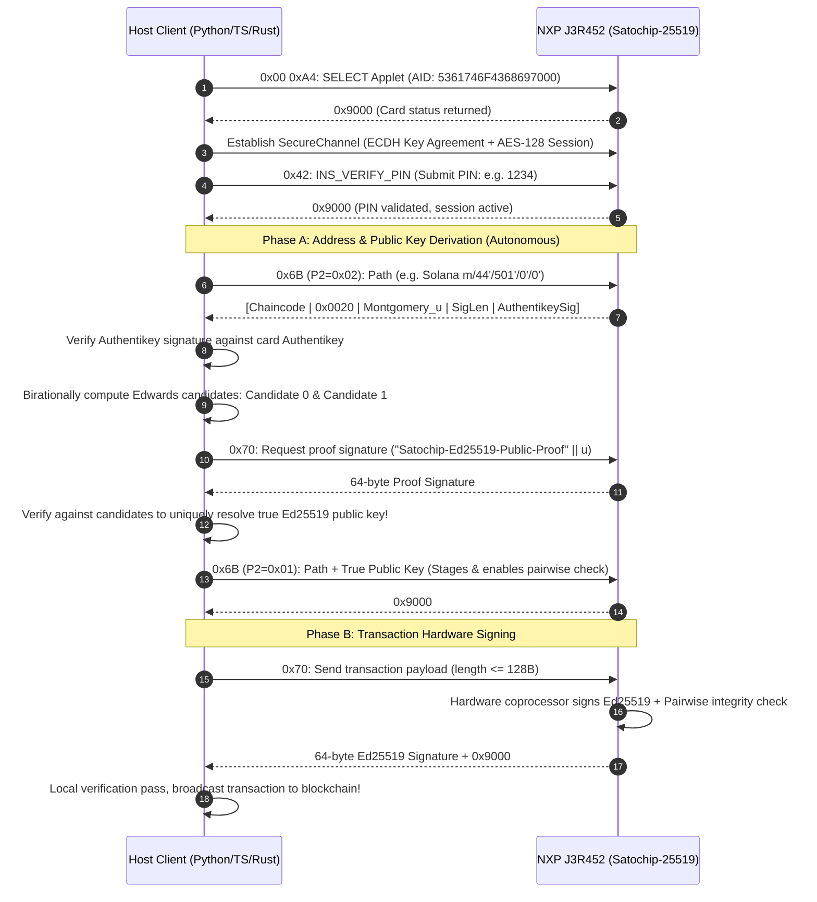

# Satochip-25519-J3R452 Protocol Specification & Developer Whitepaper
## (Developer Specification & Protocol Reference)

> **Project Name**: `Satochip-25519-J3R452` (Curve25519 Hardware-Accelerated Fork based on Satochip Architecture)  
> **Version**: v1.1-Production-Draft  
> **Target Hardware**: NXP JCOP 4.5 / J3R452 (P71D600)  
> **Dependencies**: `suut/Curve25519-JavaCard` (Package AID: `FF00025519`)  
> **Target Audience**: Web3 Wallet Developers, SDK / Host Driver Engineers, Smart Card Security Auditors  
> **Language**: [English (Current)](SPECIFICATION-Curve25519.en.md) | [中文 (Chinese)](SPECIFICATION-Curve25519.zh-CN.md)  

---

## Table of Contents
- [1. Overview & Design Philosophy](#1-overview--design-philosophy)
- [2. Cryptographic Architecture & Key Derivation Model](#2-cryptographic-architecture--key-derivation-model)
  - [2.1 Dual-Curve Physically Isolated State Machines](#21-dual-curve-physically-isolated-state-machines)
  - [2.2 SLIP-0010 Hardened Derivation & Exception Handling](#22-slip-0010-hardened-derivation--exception-handling)
  - [2.3 X25519 Birational Equivalence Coordinate Inversion](#23-x25519-birational-equivalence-coordinate-inversion)
  - [2.4 Authentikey Identity Binding & Tamper Resistance](#24-authentikey-identity-binding--tamper-resistance)
  - [2.5 Strong Transaction-Bound 2FA Architecture (WYSIWYS)](#25-strong-transaction-bound-2fa-architecture-wysiwys)
  - [2.6 Honest Security Boundaries & Threat Model](#26-honest-security-boundaries--threat-model)
- [3. Extended APDU Command Set Specification](#3-extended-apdu-command-set-specification)
  - [3.1 INS 0x3C: INS_GET_STATUS (Card Status Query)](#31-ins-0x3c-ins_get_status-card-status-query)
  - [3.2 INS 0x6B: INS_SLIP10_GET_EXTENDED_KEY (Derivation & Key Export)](#32-ins-0x6b-ins_slip10_get_extended_key-derivation--key-export)
  - [3.3 INS 0x70: INS_SIGN_ED25519_MESSAGE (Hardware Ed25519 Signature)](#33-ins-0x70-ins_sign_ed25519_message-hardware-ed25519-signature)
  - [3.4 INS 0x68: INS_X25519_KEY_AGREEMENT (X25519 Key Agreement)](#34-ins-0x68-ins_x25519_key_agreement-x25519-key-agreement)
  - [3.5 Status Words (SW) Authoritative Reference](#35-status-words-sw-authoritative-reference)
- [4. Host Client Implementation Guide](#4-host-client-implementation-guide)
  - [4.1 Standard Lifecycle Sequence Diagram](#41-standard-lifecycle-sequence-diagram)
  - [4.2 Core Algorithm: Inverting Montgomery Coordinates to Ed25519 Public Keys (Python Reference)](#42-core-algorithm-inverting-montgomery-coordinates-to-ed25519-public-keys-python-reference)
- [5. Appendix: Multi-Chain Derivation Paths & Standard Vectors](#5-appendix-multi-chain-derivation-paths--standard-vectors)

---

## 1. Overview & Design Philosophy

This document defines the **`Satochip-25519-J3R452`** protocol specification. Built upon the open-source **SatochipApplet** architecture, this hard fork introduces native hardware-accelerated **Ed25519 digital signatures**, **X25519 key exchange**, and **SLIP-0010 multi-chain child key derivation** specifically tailored for **NXP J3R452** secure smart cards.

### Core Design Principles
1. **Zero Regression & Full Backward Compatibility**: All original secp256k1 subsystems (Bitcoin/Ethereum BIP32 derivation, ECDSA, BIP340 Schnorr, Taproot, MuSig2) remain 100% untouched in their execution paths and security boundaries. Official clients such as Electrum-Satochip and Satomask operate without modification.
2. **Unified Lifecycle & Access Control**: The Ed25519 and secp256k1 cryptographic domains share the single BIP39 Master Seed, unified PIN authentication state, shared retry counter (PIN/PUK attempts), and shared SecureChannel session.
3. **Fail-Closed Security Posture**: Any derivation failure or non-hardened path automatically purges transient secret keys in card RAM, preventing residual key material from being misused for unauthorized signing.

---

## 2. Cryptographic Architecture & Key Derivation Model

### 2.1 Dual-Curve Physically Isolated State Machines

Inside the JavaCard applet, the two asymmetric cryptographic systems reside in strictly isolated memory allocations:

```
                    ┌───────────────────────────────────────┐
                    │       BIP39 Master Seed (16-64B)      │
                    └──────────────────┬────────────────────┘
                                       │ (Single import, dual derivation)
                      ┌────────────────┴────────────────┐
                      ▼                                 ▼
          ┌───────────────────────┐         ┌───────────────────────┐
          │   secp256k1 State     │         │   Curve25519 State    │
          ├───────────────────────┤         ├───────────────────────┤
          │ • bip32_masterkey     │         │ • ed25519_masterkey   │
          │ • bip32_extendedkey   │         │ • ed25519_extendedkey │
          │ • "Bitcoin seed" salt │         │ • "ed25519 seed" salt │
          │ • BIP32 scalar add    │         │ • SLIP-0010 hash cut  │
          │ • BTC / ETH / Taproot │         │ • SOL/TON/SUI/DOT/NEAR│
          └───────────────────────┘         └───────────────────────┘
```

* **Seed Initialization**: When importing a seed via `INS_BIP32_IMPORT_SEED` (`0x6C`), the card executes HMAC-SHA512 concurrently with salts `"Bitcoin seed"` and `"ed25519 seed"`, deriving independent master keys and chain codes.
* **Unified Access Control**: Validating the user PIN activates signing capabilities across both curves simultaneously. Disconnecting or powering down immediately zeroes out transient private keys in RAM.

---

### 2.2 SLIP-0010 Hardened Derivation & Exception Handling

According to the **SLIP-0010** standard, because the twisted Edwards curve Ed25519 does not mathematically permit non-hardened public key derivation, **all path segments must be strictly hardened**:
* Each path index $i$ must have its most significant bit set: $i \ge 2^{31}$ (`0x80000000` $\le i \le$ `0xFFFFFFFF`).
* **Exception Rule**: If any segment in the requested path is not hardened, the applet immediately terminates and aborts with `SW_SLIP10_NON_HARDENED` (`0x9C4D`).
* **Derivation Formula**:
  $$I = \text{HMAC-SHA512}(Key=c_{par}, Data=0x00 \parallel k_{par} \parallel ser_{32}(i))$$
  Child private key: $k_{child} = I_L$ (left 32 bytes), child chaincode: $c_{child} = I_R$ (right 32 bytes).

---

### 2.3 X25519 Birational Equivalence Coordinate Inversion

#### Root Problem
The underlying JCOP hardware library `suut/Curve25519-JavaCard` exposes only `sign()` and `verify()` APIs. **It does not expose an API to directly compute the Edwards public key point $(A = a \cdot B)$ from a private key.** Without on-card address derivation, the card cannot function as an autonomous hardware wallet.

#### Mathematical Solution
The twisted Edwards curve Ed25519 and Montgomery curve X25519 are isomorphic under birational equivalence:
1. **Export Montgomery Coordinate**: The client sends `0x6B` with **`P2 = 0x02`**. The applet executes X25519 scalar multiplication against base point $u = 9$ using the hardware coprocessor, returning the **Montgomery $u$-coordinate (32 bytes)** of the staged private key.
2. **Compute Edwards $y$-Coordinate**:
   $$y = \frac{u - 1}{u + 1} \pmod p \quad \text{where } p = 2^{255} - 19$$
3. **Compute Two Candidate Edwards Keys**:
   From curve equation $-x^2 + y^2 = 1 + d x^2 y^2$, solve for $x^2 = \frac{y^2 - 1}{d y^2 + 1} \pmod p$. Because modular square roots yield two solutions $(\pm x)$, exactly two Edwards public key candidates exist:
   $$\text{Candidate 0: } (x, y) \quad \text{and} \quad \text{Candidate 1: } (-x, y)$$
4. **Signature Proof Disambiguation**:
   The client constructs a domain-separated proof message:
   $$\text{ProofMsg} = \text{"Satochip-Ed25519-Public-Proof"} \parallel \text{PathBytes} \parallel u$$
   The client requests a signature via `INS_SIGN_ED25519_MESSAGE` (`0x70`). Testing verification against both candidates uniquely identifies the true Ed25519 public key.
5. **Pairwise Staging**:
   The host re-invokes `0x6B` with **`P2 = 0x01`**, passing the verified public key back to the card. This caches the public key and enables on-card pairwise verification for all subsequent signatures.

---

### 2.4 Authentikey Identity Binding & Tamper Resistance

To protect against Man-in-the-Middle (MITM) attacks or rogue host proxies altering derived chain codes or public keys, `Satochip-25519-J3R452` leverages the card's native Authentikey signature mechanism:
* The response payload for `0x6B` follows:
  $$\text{Payload} = [\text{Chaincode}(32B) \parallel \text{PubkeyLen}(2B) \parallel \text{Pubkey}(0B/32B)]$$
  $$\text{Response} = [\text{Payload} \parallel \text{SigLen}(2B) \parallel \text{Authentikey\_ECDSA\_Signature}]$$
* **The host client MUST verify this ECDSA signature against the card's Authentikey (secp256k1 public key)**. If the signature is invalid or tampered with, the host must immediately abort the session.

---

### 2.5 Strong Transaction-Bound 2FA Architecture (WYSIWYS)

When 2FA is enabled on the card (`needs_2FA = true`), all sensitive signing and key agreement APDUs require an accompanying 20-byte HMAC authorization token generated by a secondary device (e.g. mobile companion app).

#### Full-Message Binding Algorithm
* **Ed25519 Message Signatures**:
  $$\text{Digest} = \text{SHA256}(\text{full\_message})$$
  $$\text{Token} = \text{HMAC-SHA1}(K_{2FA}, \text{Digest} \parallel 0xCE^{32})$$
  *Regardless of whether the transaction payload is 1 byte or 128 bytes, the token strictly binds the complete SHA-256 digest. Modifying any byte immediately invalidates the token.*
* **X25519 Key Agreement (Domain Separated)**:
  $$\text{Token} = \text{HMAC-SHA1}(K_{2FA}, \text{remote\_u} \parallel 0xCF^{32})$$
  *Uses isolated padding byte `0xCF` to prevent token cross-replay between signing and agreement.*

---

### 2.6 Honest Security Boundaries & Threat Model

In accordance with rigorous open-source standards, the exact security boundaries must be explicitly declared:
1. **NXP J3R452 Hardware CC EAL6+**: Certification applies to the NXP silicon and JCOP 4.5 CardOS platform. **It does not imply that upper-layer applet software has obtained an EAL6+ certificate.**
2. **HMAC-SHA512 Side-Channel Boundary**: J3R452 firmware does not expose hardware `ALG_HMAC_SHA_512`. The 128-byte XOR loop runs in JavaCard bytecode, while SHA-512 rounds execute on the hardware hashing coprocessor. **If the physical card is captured and subjected to micro-probing differential power analysis (DPA), an attack surface theoretically exists.** However, the card is completely immune to network attacks, software trojans, and brute-force extraction without physical hardware tampering.
3. **Curve25519 Hardware Coprocessor**: Relies on the pre-installed `FF00025519` native library. EdDSA signatures execute on silicon hardware, with an average execution latency of ~220ms.

---

## 3. Extended APDU Command Set Specification

All `Satochip-25519-J3R452` commands use `CLA = 0xB0` and require an active **SecureChannel (AES-128-CBC + HMAC-SHA1)** session.

### 3.1 INS 0x3C: INS_GET_STATUS (Card Status Query)

* **CLA**: `0xB0` | **INS**: `0x3C` | **P1**: `0x00` | **P2**: `0x00`
* **Lc**: `0x00` | **Le**: `0x00` (19 bytes returned)
* **Response Payload Structure**:

| Offset | Field Name | Length | Description |
| :---: | :--- | :---: | :--- |
| `0..1` | Protocol Version | 2B | Protocol version (e.g. `0x00 0x10`) |
| `2..3` | Applet Version | 2B | Applet firmware version |
| `4..7` | PIN / PUK Tries | 4B | `[PIN0_tries, PUK0_tries, 0x00, 0x00]` |
| `8` | needs_2FA | 1B | `0x00`: Disabled; `0x01`: 2FA Required |
| `9` | is_seeded | 1B | `0x00`: Unseeded; `0x01`: Master Seed Initialized |
| `10` | setup_done | 1B | `0x00`: Setup pending; `0x01`: Setup Complete |
| `11` | secure_channel | 1B | Constant `0x01` (SecureChannel Enforced) |
| `12` | nfc_policy | 1B | NFC communication policy flags |
| `13..17`| feature_policies | 5B | Schnorr, Nostr, Liquid, MuSig2 policy bytes |
| **`18`** | **feature_ed25519_policy** | **1B** | **`0x00`: ENABLED (Curve25519 Hardware Engine Active)** |

---

### 3.2 INS 0x6B: INS_SLIP10_GET_EXTENDED_KEY (Derivation & Key Export)

Performs SLIP-0010 hardened key derivation and caches the generated child private key in RAM.

* **CLA**: `0xB0` | **INS**: `0x6B`
* **P1**: `depth` (Derivation path depth, $0 \le \text{depth} \le 10$)
* **P2**: Operational Mode Flag:
  * **`0x00`**: Derive and stage key internally; do not return or accept public keys.
  * **`0x01`**: Stage and verify against host-supplied 32-byte Ed25519 public key (enables pairwise check).
  * **`0x02`**: Derive and export 32-byte Montgomery $u$-coordinate for host public key recovery.
* **Data Field (Lc)**:
  * If $P2 \in \{0x00, 0x02\}$: $[path(4 \times depth)]$
  * If $P2 == 0x01$: $[path(4 \times depth) \parallel pubkey(32B)]$
* **Response Payload Format**:
  $$\text{Response} = [\text{chaincode}(32B) \parallel \text{pub\_len}(2B) \parallel \text{public\_val}(0B/32B) \parallel \text{sig\_len}(2B) \parallel \text{authentikey\_sig}]$$
  * When $P2 = 0x02$, `public_val` contains the 32-byte Montgomery $u$-coordinate and `pub_len` is `0x0020`.
  * The trailing Authentikey ECDSA signature certifies the payload to prevent host tampering.

---

### 3.3 INS 0x70: INS_SIGN_ED25519_MESSAGE (Hardware Ed25519 Signature)

Signs the provided message with the currently staged Ed25519 private key using the on-card hardware coprocessor.

* **CLA**: `0xB0` | **INS**: `0x70`
* **P1**: `0xFF` (Must specify `0xFF` to reference the staged key)
* **P2**: `0x00`
* **Data Field (Lc)**:
  * **Standard (No 2FA)**: $[msg\_bytes]$ ($1 \le L \le 149$ bytes)
  * **2FA Enabled**: $[msg\_bytes \parallel 0x8000 \parallel 20B\_HMAC\_Token]$ (Max message length: 127 bytes)
* **Response Payload**:
  * Success: $[sig(64B)]$ (Standard RFC 8032 $R \parallel S$ format) + `0x9000`
  * If a public key was staged, the card executes internal pairwise verification. A mismatch yields `SW_SIGNATURE_INVALID` (`0x9C0B`).

---

### 3.4 INS 0x68: INS_X25519_KEY_AGREEMENT (X25519 Key Agreement)

Computes RFC 7748 Diffie-Hellman shared secret between staged private key and remote public coordinate.

* **CLA**: `0xB0` | **INS**: `0x68`
* **P1**: `0xFF` | **P2**: `0x00`
* **Data Field (Lc)**:
  * **Standard (No 2FA)**: $[remote\_public\_u(32B)]$ (Exact 32 bytes)
  * **2FA Enabled**: $[remote\_public\_u(32B) \parallel 0x8000 \parallel 20B\_HMAC\_Token]$ (Exact 54 bytes)
* **Security Defenses**: Automatically normalizes alias coordinates ($u \ge p$), strictly rejects low-order points and all-zero shared secrets.
* **Response Payload**:
  * Success: $[shared\_secret(32B)]$ + `0x9000`

---

### 3.5 Status Words (SW) Authoritative Reference

| Status Word | Constant Identifier | Diagnostic Explanation |
| :---: | :--- | :--- |
| **`0x9000`** | `SW_OK` | Execution succeeded normally |
| **`0x6700`** | `SW_WRONG_LENGTH` | APDU length mismatch or exceeds 149-byte buffer |
| **`0x6A80`** | `SW_WRONG_DATA` | Invalid parameters or malformed input encoding |
| **`0x9C06`** | `SW_UNAUTHORIZED` | Unauthorized access (PIN must be verified first) |
| **`0x9C0B`** | `SW_SIGNATURE_INVALID` | Pairwise verification failed, or 2FA HMAC token mismatch |
| **`0x9C10`** | `SW_INCORRECT_P1` | P1 invalid (e.g. signing P1 != 0xFF, or depth > 10) |
| **`0x9C11`** | `SW_INCORRECT_P2` | P2 invalid (e.g. 0x6B passed value other than 0x00/0x01/0x02) |
| **`0x9C14`** | `SW_BIP32_UNINITIALIZED_SEED`| Master Seed has not been imported yet |
| **`0x9C20`** | `SW_SECURE_CHANNEL_REQUIRED`| Command requires active SecureChannel session |
| **`0x9C4A`** | `SW_FEATURE_DISABLED` | Ed25519 feature disabled by card management policy |
| **`0x9C4D`** | `SW_SLIP10_NON_HARDENED` | **Non-hardened path detected**: SLIP-0010 requires hardened indexes |
| **`0x9C4E`** | `SW_ED25519_UNINITIALIZED` | **No key staged**: Must call 0x6B before calling 0x70 |
| **`0x9C4F`** | `SW_X25519_FAILURE` | **X25519 failure**: Low-order point or all-zero shared secret rejected |

---

## 4. Host Client Implementation Guide

### 4.1 Standard Lifecycle Sequence Diagram



---

### 4.2 Core Algorithm: Inverting Montgomery Coordinates to Ed25519 Public Keys (Python Reference)

```python
import hashlib
from cryptography.hazmat.primitives.asymmetric import ed25519

FIELD_P = (1 << 255) - 19
PROOF_TAG = b"Satochip-Ed25519-Public-Proof"

def ed25519_candidates_from_x25519(public_u_bytes: bytes) -> tuple:
    """Invert 32-byte Montgomery u-coordinate to two candidate Edwards public keys."""
    u = int.from_bytes(public_u_bytes, "little")
    if u >= FIELD_P:
        raise ValueError("Non-canonical Montgomery u coordinate")
    
    denominator = (u + 1) % FIELD_P
    if denominator == 0:
        raise ValueError("Point has no Edwards mapping")
        
    # Birational map: y = (u - 1) / (u + 1) mod p
    y = ((u - 1) * pow(denominator, FIELD_P - 2, FIELD_P)) % FIELD_P
    encoded = bytearray(y.to_bytes(32, "little"))
    
    candidate0 = bytes(encoded)        # x sign bit = 0
    encoded[31] |= 0x80
    candidate1 = bytes(encoded)        # x sign bit = 1
    return candidate0, candidate1

def recover_ed25519_public_key(public_u_bytes: bytes, path_bytes: bytes, proof_sig: bytes) -> bytes:
    """Disambiguate true Ed25519 public key using proof signature."""
    proof_msg = PROOF_TAG + path_bytes + public_u_bytes
    cand0, cand1 = ed25519_candidates_from_x25519(public_u_bytes)
    
    for candidate in (cand0, cand1):
        try:
            pub = ed25519.Ed25519PublicKey.from_public_bytes(candidate)
            pub.verify(proof_sig, proof_msg)
            return candidate  # Verification succeeded, resolved unique public key
        except Exception:
            pass
            
    raise RuntimeError("Failed to disambiguate Ed25519 candidate: invalid proof signature!")
```

---

## 5. Appendix: Multi-Chain Derivation Paths & Standard Vectors

`Satochip-25519-J3R452` natively supports all SLIP-0010 Ed25519 blockchains:

| Blockchain | BIP44 Derivation Path | Big-Endian Path Hex | Address Encoding Standard |
| :--- | :--- | :--- | :--- |
| **Solana** | `m/44'/501'/0'/0'` | `8000002C 800001F5 80000000 80000000` | Base58 encoding (32-byte public key) |
| **TON** | `m/44'/607'/0'` | `8000002C 8000025F 80000000` | Base64URL user-friendly address (tag + workchain) |
| **Sui** | `m/44'/784'/0'/0'/0'` | `8000002C 80000310 80000000 80000000 80000000` | `0x` + Blake2b-256(`0x00` + pubkey) |
| **Aptos** | `m/44'/637'/0'/0'/0'` | `8000002C 8000027D 80000000 80000000 80000000` | `0x` + SHA3-256(pubkey + `0x00`) |
| **Polkadot** | `m/44'/354'/0'/0'/0'` | `8000002C 80000162 80000000 80000000 80000000` | SS58 encoding (prefix `0x00`) |
| **Near** | `m/44'/397'/0'` | `8000002C 8000018D 80000000` | Hex-encoded public key (implicit account) |

---
*Archived: 2026-10-25 | Verified CAP SHA-256: `94b9c1c3b124167e5e4b7c3944ba1f30db5b5fb29444347ba4751038c05e8a2c`*
