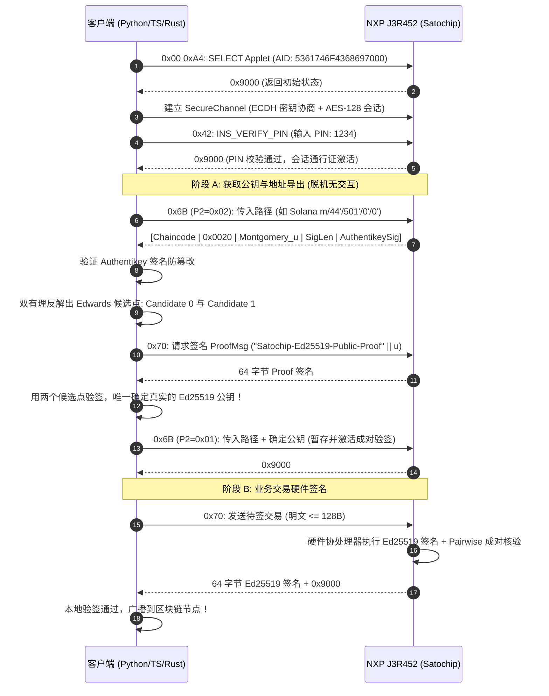

# Satochip-25519-J3R452 扩展协议接口定义与开发者白皮书
## (Developer Specification & Protocol Reference)

> **项目名称**：`Satochip-25519-J3R452` (基于 Satochip 架构的 Curve25519 硬件加速增强版)  
> **版本**：v1.1-Production-Draft  
> **适用卡片**：NXP JCOP 4.5 / J3R452 (P71D600)  
> **依赖库**：`suut/Curve25519-JavaCard` (Package AID: `FF00025519`)  
> **目标读者**：Web3 钱包开发者、SDK/上位机驱动工程师、智能卡安全研究员  
> **文档语言**：[中文 (当前)](SPECIFICATION-Curve25519.zh-CN.md) | [English](SPECIFICATION-Curve25519.en.md)  

---

## 目录
- [一、 概述与设计哲学](#一-概述与设计哲学)
- [二、 密码学体系与密钥派生模型](#二-密码学体系与密钥派生模型)
  - [1. 双曲线物理隔离双状态机](#1-双曲线物理隔离双状态机)
  - [2. SLIP-0010 硬派生规范与异常约束](#2-slip-0010-硬派生规范与异常约束)
  - [3. X25519 双有理等价坐标反解技术（核心破局创新）](#3-x25519-双有理等价坐标反解技术核心破局创新)
  - [4. Authentikey 身份绑定与防伪防篡改](#4-authentikey-身份绑定与防伪防篡改)
  - [5. 交易强绑定 2FA 架构 (WYSIWYS)](#5-交易强绑定-2fa-架构-wysiwys)
  - [6. 密码学执行引擎与项目属性说明](#6-密码学执行引擎与项目属性说明)
- [三、 扩展 APDU 指令全集规范](#三-扩展-apdu-指令全集规范)
  - [1. INS 0x3C: INS_GET_STATUS (卡片状态查询)](#1-ins-0x3c-ins_get_status-卡片状态查询)
  - [2. INS 0x6B: INS_SLIP10_GET_EXTENDED_KEY (派生与公钥/坐标获取)](#2-ins-0x6b-ins_slip10_get_extended_key-派生与公钥坐标获取)
  - [3. INS 0x70: INS_SIGN_ED25519_MESSAGE (Ed25519 硬件签名)](#3-ins-0x70-ins_sign_ed25519_message-ed25519-硬件签名)
  - [4. INS 0x68: INS_X25519_KEY_AGREEMENT (X25519 密钥协商)](#4-ins-0x68-ins_x25519_key_agreement-x25519-密钥协商)
  - [5. 状态字 (Status Words) 权威速查表](#5-状态字-status-words-权威速查表)
- [四、 客户端开发实战指南](#四-客户端开发实战指南)
  - [1. 标准交互生命周期流程图](#1-标准交互生命周期流程图)
  - [2. 关键算法：Montgomery 坐标反算 Ed25519 公钥 (Python 参考实现)](#2-关键算法montgomery-坐标反算-ed25519-公钥-python-参考实现)
- [五、 附录：多链派生路径与标准向量速查](#五-附录多链派生路径与标准向量速查)

---

## 一、 概述与设计哲学

本规范定义了 **`Satochip-25519-J3R452`** 协议标准。该工程在官方 **SatochipApplet** 架构之上进行了硬分支增强，专门为 **NXP J3R452** 智能卡引入原生硬件加速的 **Ed25519 数字签名**、**X25519 密钥协商**以及 **SLIP-0010 多链子私钥派生**能力。

### 核心设计原则
1. **零回归与完全向后兼容（Zero Regression）**：原有 secp256k1 体系（比特币/以太坊 BIP32 派生、ECDSA、BIP340 Schnorr、Taproot、MuSig2）的代码路径与安全边界 100% 保持原样，原版的 Electrum-Satochip、Satomask 等客户端不受任何影响。
2. **统一的生命周期与访问控制**：Ed25519 体系与 secp256k1 体系共享卡片唯一的 BIP39 Master Seed、统一 PIN 鉴权状态、统一失败重试计数器（PIN retry counter）以及统一的 SecureChannel。
3. **Fail-Closed 故障防护**：任何派生异常或非合法路径，均强制在芯片内部彻底清空暂存私钥，杜绝利用残留密钥冒名签署的隐患。

---

## 二、 密码学体系与密钥派生模型

### 1. 双曲线物理隔离双状态机

在 Applet 内部，两套非对称密码体系在内存中完全物理隔离：

```
                    ┌───────────────────────────────────────┐
                    │       BIP39 助记词根种子 (Seed)         │
                    └──────────────────┬────────────────────┘
                                       │ (一次导入，双轨计算)
                      ┌────────────────┴────────────────┐
                      ▼                                 ▼
          ┌───────────────────────┐         ┌───────────────────────┐
          │   secp256k1 状态机    │         │  Curve25519 状态机    │
          ├───────────────────────┤         ├───────────────────────┤
          │ • bip32_masterkey     │         │ • ed25519_masterkey   │
          │ • bip32_extendedkey   │         │ • ed25519_extendedkey │
          │ • "Bitcoin seed" 盐值 │         │ • "ed25519 seed" 盐值 │
          │ • BIP32 标量模加算法  │         │ • SLIP-0010 纯散列截取│
          │ • BTC / ETH / Taproot │         │ • SOL/TON/SUI/DOT/NEAR│
          └───────────────────────┘         └───────────────────────┘
```

* **种子初始化**：调用 `INS_BIP32_IMPORT_SEED` (`0x6C`) 导入种子时，卡内同时以 `"Bitcoin seed"` 和 `"ed25519 seed"` 执行 HMAC-SHA512，生成两套独立的根密钥与根链码（Root Chaincode）。
* **访问控制共享**：PIN 校验成功后，双曲线签名能力同时激活；卡片拔出掉电或软件断开后，两套暂存私钥同时在 RAM 中蒸发。

---

### 2. SLIP-0010 硬派生规范与异常约束

根据 **SLIP-0010** 规范，由于 Ed25519 扭曲爱德华曲线在数学上不支持公钥直接进行标量模加，**所有衍生路径必须严格为硬派生（Hardened Derivation）**：
* 路径索引 $i$ 的最高位必须置位，即 $i \ge 2^{31}$（$0x80000000 \le i \le 0xFFFFFFFF$）。
* **异常处理**：若 APDU 传入的任意一级路径索引最高位未置位（非硬派生），Applet 立即阻断并抛出 `SW_SLIP10_NON_HARDENED` (`0x9C4D`)。
* 派生算法：
  $$I = \text{HMAC-SHA512}(Key=c_{par}, Data=0x00 \parallel k_{par} \parallel ser_{32}(i))$$
  子私钥 $k_{child} = I_L$（左 32 字节），子链码 $c_{child} = I_R$（右 32 字节）。

---

### 3. X25519 双有理等价坐标反解技术（核心破局创新）

#### 痛点根因
第三方 JCOP 硬件库 `suut/Curve25519-JavaCard` 仅暴露了 `sign()` 和 `verify()` 接口，**未提供从私钥计算 Edwards 公钥点 $(A = a \cdot B)$ 的正向推导函数**。如果让客户端自备公钥，卡片就无法完全脱机独立派生地址。

#### 破局机制
Ed25519（Twisted Edwards 曲线）与 X25519（Montgomery 曲线）在双有理等价变换（Birational Equivalence）下同构：
1. **获取 Montgomery 坐标**：客户端发送 `0x6B` 且设定 **`P2 = 0x02`**，Applet 调度底层硬件 X25519 引擎对基点 $u = 9$ 执行标量乘法，导出当前派生私钥对应的 **Montgomery $u$ 坐标（32 字节）**。
2. **反解 Edwards $y$ 坐标**：
   $$y = \frac{u - 1}{u + 1} \pmod p \quad \text{其中 } p = 2^{255} - 19$$
3. **计算两个候选公钥**：
   根据曲线方程 $-x^2 + y^2 = 1 + d x^2 y^2$，计算 $x^2 = \frac{y^2 - 1}{d y^2 + 1} \pmod p$。因为模平方根有两个解 $(\pm x)$，对应且仅对应两个候选 Edwards 公钥：
   $$\text{Candidate 0: } (x, y) \quad \text{与} \quad \text{Candidate 1: } (-x, y)$$
4. **签名证明消歧（Signature Proof Disambiguation）**：
   客户端构造一段固定域隔离证明报文：
   $$\text{ProofMsg} = \text{"Satochip-Ed25519-Public-Proof"} \parallel \text{PathBytes} \parallel u$$
   调用 `INS_SIGN_ED25519_MESSAGE` (`0x70`) 索取卡片签名。用两个候选公钥分别验签，**只有真正的 Ed25519 公钥能验签通过**。
5. **回填暂存（Pairwise Staging）**：
   确定公钥后，客户端发送 `0x6B` 附带 **`P2 = 0x01`** 将确立的公钥暂存进卡片，激活后续签名的成对一致性校验（Pairwise Verification）。

---

### 4. Authentikey 身份绑定与防伪防篡改

为防止恶意中间人（MITM）或恶意上位机代理篡改派生出的链码或公钥，Applet 沿用了 Satochip 官方的 Authentikey 背书机制：
* 每次调用 `0x6B`，卡片返回的数据格式为：
  $$\text{Payload} = [\text{Chaincode}(32B) \parallel \text{PubkeyLen}(2B) \parallel \text{Pubkey}(0B/32B)]$$
  $$\text{Response} = [\text{Payload} \parallel \text{SigLen}(2B) \parallel \text{Authentikey\_ECDSA\_Signature}]$$
* **客户端必须使用卡片的 Authentikey（secp256k1 公钥）对该签名进行核验**。如果签名无效或被篡改，客户端必须立刻拒绝该派生结果。

---

### 5. 交易强绑定 2FA 架构 (WYSIWYS)

当卡片开启 2FA (`needs_2FA = true`) 时，必须在 APDU 尾部附带手机端授权的 20 字节印章。

#### 强绑定算法（彻底根除截断篡改漏洞）
* **Ed25519 签名 2FA 校验**：
  $$\text{Digest} = \text{SHA256}(\text{full\_message})$$
  $$\text{Token} = \text{HMAC-SHA1}(K_{2FA}, \text{Digest} \parallel 0xCE^{32})$$
  *无论消息为 1 字节还是 128 字节，均绑定全消息 SHA-256 摘要。篡改 32 字节之后的任意数据，印章必定失效。*
* **X25519 协商 2FA 校验（域隔离）**：
  $$\text{Token} = \text{HMAC-SHA1}(K_{2FA}, \text{remote\_u} \parallel 0xCF^{32})$$
  *使用独立填充常量 `0xCF`，防止不同类型的 2FA 授权相互重放。*

---

### 6. 密码学执行引擎与项目属性说明

本项目属于实验性增强分支。与原版 SatochipApplet 相同，密钥派生（BIP32 / SLIP-0010）均采用软件 HMAC-SHA512 配合卡内硬件 SHA-512 协处理器执行；Curve25519（Ed25519 签名与 X25519 密钥协商）则由 NXP 原生底层硬件协同处理器提供全硬件加速（依赖预装的 `FF00025519` 扩展包，单次耗时约 220ms）。

---

## 三、 扩展 APDU 指令全集规范

所有 Satochip 指令均使用 `CLA = 0xB0`，要求在已建立的 **SecureChannel (AES-128-CBC + HMAC-SHA1)** 内传输。

### 1. INS 0x3C: INS_GET_STATUS (卡片状态查询)

* **CLA**: `0xB0` | **INS**: `0x3C` | **P1**: `0x00` | **P2**: `0x00`
* **Lc**: `0x00` (无数据) | **Le**: `0x00` (预期 19 字节)
* **返回载荷结构**：

| 字节偏移 | 字段名称 | 长度 | 说明 |
| :---: | :--- | :---: | :--- |
| `0..1` | Protocol Version | 2B | 通信协议版本号 (如 `0x00 0x10`) |
| `2..3` | Applet Version | 2B | Applet 固件版本号 |
| `4..7` | PIN / PUK Tries | 4B | `[PIN0_tries, PUK0_tries, 0x00, 0x00]` |
| `8` | needs_2FA | 1B | `0x00`: 未启用; `0x01`: 启用 2FA |
| `9` | is_seeded | 1B | `0x00`: 空白未初始化; `0x01`: 已导入 Seed |
| `10` | setup_done | 1B | `0x00`: 未初始化 PIN; `0x01`: setup 已完成 |
| `11` | secure_channel | 1B | 固定为 `0x01` (强制安全通道) |
| `12` | nfc_policy | 1B | NFC 通信策略标志位 |
| `13..17`| feature_policies | 5B | 包含 Schnorr、Nostr、Liquid、MuSig2 策略 |
| **`18`** | **feature_ed25519_policy** | **1B** | **`0x00`: ENABLED (Curve25519 硬件引擎就绪)** |

---

### 2. INS 0x6B: INS_SLIP10_GET_EXTENDED_KEY (派生与公钥/坐标获取)

执行 SLIP-0010 硬派生，并将生成的私钥暂存到卡片 RAM 中供后续签名。

* **CLA**: `0xB0` | **INS**: `0x6B`
* **P1**: `depth`（派生深度，范围 $0 \le \text{depth} \le 10$）
* **P2**: 操作模式标志：
  * **`0x00`**：仅派生并暂存密钥，不附带也不导出公钥。
  * **`0x01`**：派生并验证附带的 32 字节 Ed25519 公钥，暂存用于后续成对校验。
  * **`0x02`**：派生并返回 32 字节 Montgomery $u$ 坐标（用于上位机反解公钥）。
* **Data 格式 (Lc)**：
  * 若 $P2 \in \{0x00, 0x02\}$：$[path(4 \times depth)]$
  * 若 $P2 == 0x01$：$[path(4 \times depth) \parallel pubkey(32B)]$
* **应答数据格式 (Response Data)**：
  $$\text{Response} = [\text{chaincode}(32B) \parallel \text{pub\_len}(2B) \parallel \text{public\_val}(0B/32B) \parallel \text{sig\_len}(2B) \parallel \text{authentikey\_sig}]$$
  * 当 $P2 = 0x02$ 时，`public_val` 为 32 字节 Montgomery $u$ 坐标，`pub_len` 为 `0x0020`。
  * 尾部包含由 Authentikey 签发的完整 DER 签名，用于主机端防伪校验。

---

### 3. INS 0x70: INS_SIGN_ED25519_MESSAGE (Ed25519 硬件签名)

使用卡内当前暂存的 Ed25519 私钥，调用底层硬件协处理器签署消息。

* **CLA**: `0xB0` | **INS**: `0x70`
* **P1**: `0xFF`（强制使用暂存密钥，其它值报错）
* **P2**: `0x00`（强制为 0x00）
* **Data 格式 (Lc)**：
  * **无 2FA**：$[msg\_bytes]$（长度 $1 \le L \le 149$ 字节）
  * **开启 2FA**：$[msg\_bytes \parallel 0x8000 \parallel 20B\_HMAC\_Token]$（明文长度最长 127 字节）
* **应答数据格式**：
  * 成功：$[sig(64B)]$（标准的 RFC 8032 $R \parallel S$ 格式）+ `0x9000`
  * 若此前暂存过公钥，卡内会自动执行成对验签（Pairwise Verification），验签失败抛出 `SW_SIGNATURE_INVALID` (`0x9C0B`)。

---

### 4. INS 0x68: INS_X25519_KEY_AGREEMENT (X25519 密钥协商)

使用卡内当前暂存的私钥，与对端传入的公钥执行 RFC 7748 Diffie-Hellman 协商。

* **CLA**: `0xB0` | **INS**: `0x68`
* **P1**: `0xFF` | **P2**: `0x00`
* **Data 格式 (Lc)**：
  * **无 2FA**：$[remote\_public\_u(32B)]$（固定 32 字节）
  * **开启 2FA**：$[remote\_public\_u(32B) \parallel 0x8000 \parallel 20B\_HMAC\_Token]$（固定 54 字节）
* **安全特性**：卡内自动规约 $u \ge p$ 的别名点，强制拒绝低阶点与全零共享秘密。
* **应答数据格式**：
  * 成功：$[shared\_secret(32B)]$ + `0x9000`

---

### 5. 状态字 (Status Words) 权威速查表

| SW 码 | 状态常量名 | 说明与诊断建议 |
| :---: | :--- | :--- |
| **`0x9000`** | `SW_OK` | 指令执行成功 |
| **`0x6700`** | `SW_WRONG_LENGTH` | APDU 长度错误（如数据长度与 depth 不匹配、超出 149 字节安全通道上限） |
| **`0x6A80`** | `SW_WRONG_DATA` | 报文格式错误或包含非法参数 |
| **`0x9C06`** | `SW_UNAUTHORIZED` | 未授权访问（未输入正确 PIN 码即尝试调用敏感指令） |
| **`0x9C0B`** | `SW_SIGNATURE_INVALID` | 签名成对校验失败、或 2FA HMAC 印章校验失败 |
| **`0x9C10`** | `SW_INCORRECT_P1` | P1 参数非法（例如签名时 P1 不是 0xFF，或 depth 超出 10） |
| **`0x9C11`** | `SW_INCORRECT_P2` | P2 参数非法（例如 0x6B 传入了 0x00/0x01/0x02 以外的值） |
| **`0x9C14`** | `SW_BIP32_UNINITIALIZED_SEED`| 卡片尚未导入 Master Seed |
| **`0x9C20`** | `SW_SECURE_CHANNEL_REQUIRED`| 必须在建立 SecureChannel 加密通道后才能发送此指令 |
| **`0x9C4A`** | `SW_FEATURE_DISABLED` | Ed25519 特性策略已被管理员策略关闭 |
| **`0x9C4D`** | `SW_SLIP10_NON_HARDENED` | **路径非硬派生**：SLIP-0010 强制要求路径索引最高位置 1 |
| **`0x9C4E`** | `SW_ED25519_UNINITIALIZED` | **暂存私钥未就绪**：在未执行 0x6B 派生前就直接调用 0x70 签名 |
| **`0x9C4F`** | `SW_X25519_FAILURE` | **X25519 协商失败**：对端公钥产生全零弱密钥或底层计算异常 |

---

## 四、 客户端开发实战指南

### 1. 标准交互生命周期流程图



---

### 2. 关键算法：Montgomery 坐标反算 Ed25519 公钥 (Python 参考实现)

任何语言的客户端开发者均可直接参考以下数学实现：

```python
import hashlib
from cryptography.hazmat.primitives.asymmetric import ed25519

FIELD_P = (1 << 255) - 19
PROOF_TAG = b"Satochip-Ed25519-Public-Proof"

def ed25519_candidates_from_x25519(public_u_bytes: bytes) -> tuple:
    """从 32 字节 Montgomery u 坐标反解出 2 个候选 Edwards 公钥"""
    u = int.from_bytes(public_u_bytes, "little")
    if u >= FIELD_P:
        raise ValueError("非规范的 Montgomery u 坐标")
    
    denominator = (u + 1) % FIELD_P
    if denominator == 0:
        raise ValueError("无对应 Edwards 映射")
        
    # 双有理映射: y = (u - 1) / (u + 1) mod p
    y = ((u - 1) * pow(denominator, FIELD_P - 2, FIELD_P)) % FIELD_P
    encoded = bytearray(y.to_bytes(32, "little"))
    
    candidate0 = bytes(encoded)        # x 符号位为 0
    encoded[31] |= 0x80
    candidate1 = bytes(encoded)        # x 符号位为 1
    return candidate0, candidate1

def recover_ed25519_public_key(public_u_bytes: bytes, path_bytes: bytes, proof_sig: bytes) -> bytes:
    """通过 Proof 签名消歧，唯一确立真公钥"""
    proof_msg = PROOF_TAG + path_bytes + public_u_bytes
    cand0, cand1 = ed25519_candidates_from_x25519(public_u_bytes)
    
    for candidate in (cand0, cand1):
        try:
            pub = ed25519.Ed25519PublicKey.from_public_bytes(candidate)
            pub.verify(proof_sig, proof_msg)
            return candidate  # 验签成功，确立唯一真公钥
        except Exception:
            pass
            
    raise RuntimeError("无法消歧 Ed25519 候选公钥，签名证明无效！")
```

---

## 五、 附录：多链派生路径与标准向量速查

卡片原生支持所有基于 SLIP-0010 的 Ed25519 体系，标准派生路径定义如下：

| 区块链 | BIP44 路径 | 路径 Hex 编码 (Big-Endian) | 地址编码规范 |
| :--- | :--- | :--- | :--- |
| **Solana** | `m/44'/501'/0'/0'` | `8000002C 800001F5 80000000 80000000` | Base58 编码 (32 字节公钥) |
| **TON** | `m/44'/607'/0'` | `8000002C 8000025F 80000000` | Base64URL 友好地址 (带校验与 workchain) |
| **Sui** | `m/44'/784'/0'/0'/0'` | `8000002C 80000310 80000000 80000000 80000000` | `0x` + Blake2b-256(`0x00` + 公钥) |
| **Aptos** | `m/44'/637'/0'/0'/0'` | `8000002C 8000027D 80000000 80000000 80000000` | `0x` + SHA3-256(公钥 + `0x00`) |
| **Polkadot** | `m/44'/354'/0'/0'/0'` | `8000002C 80000162 80000000 80000000 80000000` | SS58 编码 (前缀 `0x00`) |
| **Near** | `m/44'/397'/0'` | `8000002C 8000018D 80000000` | Hex 编码公钥 (隐式账户) |

---
*文档归档于：2026-10-26 | 产物校验和：`9fb7394addd25dbf02d91f805aee04d106a9daa00d3e8df5dca4b6250a8b1dc4`*
